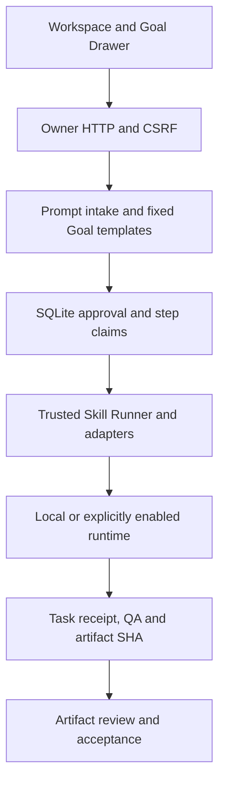

# Core runtime audit

Baseline `origin/main` at `df8c90b`, including PR #123. The checkout was
clean and GitHub listed no open PRs at inspection. This review used a Linux
checkout of the repository. Owner's Windows workstation is a separate runtime.

## Actual execution path

A worker is a manifest and routing identity in this path. The current system
does not launch one independent process per worker. The prompt selects a
template in `agentforge/ai/prompt_intake.py:plan_request`. The server plans
and validates before approvals, then `core/brain_runner.py:execute` claims a
Goal. `core/skill_runner.py:_execute` calls a trusted domain adapter and
records the result. Some media flows use separate direct Owner APIs.

## Inventory and reuse

| Layer | Evidence | Baseline state |
| --- | --- | --- |
| Frontend | `dashboard/src/App.jsx`, `features/Workspace.jsx`, `features/Operations.jsx`, `features/Models.jsx` | Owner workflow, configuration and approvals integrated. Team is a read-only overview. No unified host inventory. |
| HTTP | `agentforge/api/server.py`, `api/routes/read.py`, `api/routes/workspace.py`, `api/routes/goals.py` | Loopback Owner session, CSRF mutations, step-specific consent and immutable plan SHA. Reuse these entry points. |
| Orchestration | `core/brain_planner.py:_steps`, `core/brain_runner.py:_run_steps`, `core/task_history.py` | Fixed allowlisted templates, durable step claims, explicit recovery. No general-purpose autonomous tool loop. |
| Workers and skills | `workers/`, `skills/`, `ai/worker_registry.py:load_worker`, `core/skill_registry.py:load_skill`, `core/skill_adapters/POLICY` in the package initializer | Existing manifests and trusted policies. Reuse as authority, project dependency views from them. |
| Models | `ai/model_hub.py:catalog`, `:model_for_worker`, `model.py:resolve_runtime`, `config/task_routes.toml` | Text routing is wired. Media routes may be config-only. Model Hub provides revision and rollback. |
| Host and model probes | `ops/preflight.py:inspect`, `ops/runtime_certification.py:inspect`, `ai/model_health.py:check` | Static Dashboard preflight, richer opt-in CLI tests. Ollama metadata presence is distinct from successful generation. |
| Filesystem | `agentforge/gateway.py:safe_path/read_file/write_file`, `tool_flow.py` | Bounded workspace text read and exclusive write, separate from the main Goal tool catalog. Update, search and task evidence need integration. |
| Terminal and browser | `features/media/render.py:_run_process`, `features/webapps/browser_qa.py:verify`, `sandbox/webapp/browser_runner.mjs` | Real fixed-purpose adapters. Generated React QA uses an offline Docker boundary. Generic approved command and browser action tools are missing. Browser fixture tests do not certify Docker on Owner's PC. |
| Search and HTTP | `web_tools.py:web_search`, `source_reader.py:fetch_page`, `integrations/comfyui.py`, `integrations/youtube_private.py` | Public search and vetted retrieval are separate from browser control. Provider-specific HTTP exists. No generic authenticated HTTP tool. |
| Media | `features/websites/image_studio.py:health`, `features/film_studio/motion_comfy.py:health/submit_shot`, `api/routes/read.py` | Owner routes exist. Static MP4 previously verified with FFmpeg. Image and motion generation require live ComfyUI/GPU evidence. |
| Artifact and QA | `storage/artifact_catalog.py`, `core/artifact_acceptance.py:record_validation/decide`, `core/result_view.py` | Source SHA, versioned decisions and evidence exist for supported products. Generic filesystem/research handoff needs a contract. |

## Findings and phase order

| Priority | Gap | Action |
| --- | --- | --- |
| P1 | Hardware, configured runtime and actual model catalogs are scattered. The Dashboard cannot tell installed files from loadable models. | Phase 1 adds bounded host discovery separate from opt-in smoke and benchmark execution. Preserve existing setup and certification routes. |
| P1 | Prompt intake selects a template without a unified model/tool capability check. Media config can exist without a wired runtime. | Phase 4 uses verified evidence before proposing unsupported work, reports missing dependencies, and retains explicit paid-provider consent. |
| P1 | Main Goal flow cannot perform E2E B–E with a bounded general tool contract. Existing tooling is feature-specific. | Phase 2 reuses filesystem/search and browser QA boundaries. Add approved actions incrementally, including trace and rejection tests. |
| P1 | Full runtime E2E has no evidence on Owner Windows for Ollama, ComfyUI, Docker or the requested research handoff. | Phases 5–6 verify actual operations and preserve NOT VERIFIED for unavailable runtime. |
| P2 | Team view and Model Hub offer separate slices without skill-to-workflow impact or unified Agent/Model/Skill/Rule/Tool detail. | Phase 3 projects from existing registry and policy. Keep source edits in Git. |
| P2 | Success semantics differ by artifact. A task can succeed with a proposal that is still pending QA or acceptance. | Phase 5 reuses acceptance ledger and presents distinct execution and artifact states. |
| P3 | Compatibility imports and diagnostics are split across entry points. | Retain compatibility. Consolidate shared transport and evidence semantics where behavior is verified. |

No P0 identified in this targeted trace. This is not a guarantee that the
baseline is free of security defects. Treat retrieved content as untrusted and
keep network endpoints, process arguments, and filesystem writes bounded.
Avoid broad terminal and browser rights to satisfy a feature checkbox.
