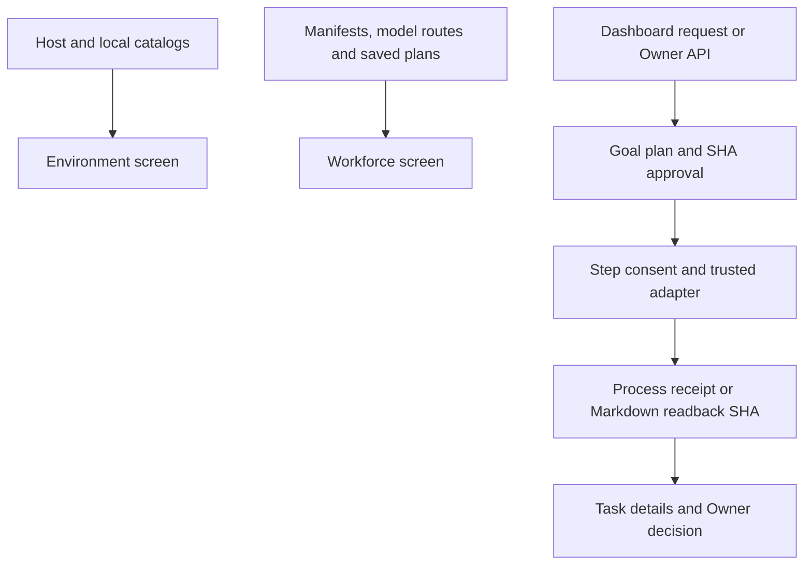

# Core runtime reconstruction report

## Executive summary

This PR implements host and local-model discovery, separates workforce
entities using the existing registries, and connects bounded Markdown and
terminal operations to reviewed Goal execution. Markdown has end-to-end
SHA evidence and an independent Owner decision. The full reconstruction
remains **NO-GO** against the requested definition of done.

## Baseline and architecture

The baseline is `df8c90b`, with PR #123's step-scoped approvals and
concurrent-claim fix. See [the baseline audit](CORE_RUNTIME_AUDIT.md) for
source trace, inventory, priority and reuse decisions. The new runtime
path preserves the existing SQLite and HTTP contracts.

## Phase evidence and verdict

| Phase | Changes, tests and evidence | Limits and verdict |
| --- | --- | --- |
| 0 Audit | Confirmed clean baseline, PR list, traced Goal/API/adapters, mapped gaps in the audit. | GO for the bounded implementation below. |
| 1 Discovery | `GET /api/ops/discovery`, `ops/discovery.py`, Environment tab, tests in `test_runtime_discovery.py`. Real Linux host and authenticated HTTP tested. | GO for Linux host inventory. Windows host, live catalogs and loadability NOT VERIFIED in the local runtime. |
| 2 Tools | `filesystem.report` and `terminal.check` use trusted manifests and adapters. Real file and Python subprocess through Owner HTTP with temporary workspace. Rejection and timeout tests cover fixed boundaries. | GO for the two named operations. Generic file update/search, terminal cancellation, browser actions and authenticated HTTP tools remain open. |
| 3 Workforce | `GET /api/workforce`, existing worker/skill/model references, reverse permission and tool edges, recent runs and saved template dependencies. Authenticated API and registry tests. | GO for read-only workload and dependency projection; observed template map is bounded to 30 plans. Dashboard editing is delegated to existing Model Hub and source changes to Git. |
| 4 Routing | Current Goal step shows effective text model metadata without invoking it. Image-first intake returns an explicit blocker or directs Owner to the existing studio. | Partial. No new automatic model fallback, hardware compatibility engine, or generalized dynamic capability planner. |
| 5 Execution and QA | Markdown exact bytes and SHA verified, then review/decision through existing ledger. Terminal exit status and bounded stdout/stderr persisted. | GO for the two new workflows. Generic trace and archive lifecycle for every skill remains open. |
| 6 Integration | Full Python regression, Dashboard/NovaMart unit/build, HTTP integration, adversarial file and process fixtures. Browser scenarios use synthetic UI fixtures. | Full reconstruction NO-GO. Tests C–H cover only the slices listed below. See PR for Windows CI. |

## Capability evidence

| Capability | Implemented | Integrated | Tested | Runtime Verified | Evidence |
| --- | --- | --- | --- | --- | --- |
| A. Host discovery | Yes | Owner API and Dashboard | API + catalog fixtures | Linux host, actual local endpoints refused connection | `ops/discovery.py`, `test_runtime_discovery.py` |
| A. Ollama and ComfyUI catalogs | Yes | Environment | Metadata fixtures, bounded local transport | NOT VERIFIED with running Ollama/ComfyUI | Installed metadata has unknown loadability; no cloud calls |
| B. Workspace Markdown | Yes | Prompt, Goal API, task receipt | HTTP and adversarial path, symlink, overwrite tests | Yes, temporary real file and readback SHA | `test_filesystem_workflow.py` |
| C. Python version diagnostic | Yes | Dashboard prompt, Goal API, task receipt | Real process, no permission, unsafe recipe, simulated timeout | Yes, fixed Python command and exit code | `terminal.check`, `test_filesystem_workflow.py` |
| D. Browser interaction | Existing feature-specific offline adapter | Generated app QA only | Existing fixture regression | NOT VERIFIED for the requested general browse/fill/screenshot flow | `features/webapps/browser_qa.py`, `sandbox/webapp/browser_runner.mjs` |
| E. Search and research | Existing delegated search/retrieval | Research workflow via existing skills | Existing source and permission tests | NOT VERIFIED for new live search-to-Markdown flow | `web_tools.py`, `source_reader.py`, `research.opportunity` |
| F. Model readiness and routing | Current-step metadata, existing routing | Goal Drawer and Model Hub | Mocked metadata, no paid call, actual discovery refusal | NOT VERIFIED for READY model inference/insufficient VRAM | `ai/model_health.py`, `test_goal_capability_check.py` |
| G. Complete research-to-archive workflow | Partial | File handoff, SHA review and owner decision | Live local Markdown path only | NOT VERIFIED for autonomous research, source QA and archival | Existing research not coupled to the new Markdown workflow |
| H. Security coverage | Scoped | Existing auth and approval retained | Escape, symlink, alternate stream, no overwrite, approval, changed SHA, timeout and no paid provider probe | Real file and fixed process scenarios only | Prompt injection and generic browser/network enforcement remain open |

## Operation and safeguards

- **Environment** in Settings queries read-only local adapters with bounded
  output and timeouts. Available endpoints and model entries have explicit
  limits. Software version probes only attest that the version command ran.
  No model load, inference, download, installation or benchmark is triggered.
  Optional runtime checks remain in the [certification runbook](../verification/runtime_2026_11/README.md).
- **Workforce** reports manifest and instruction paths, skill schemas,
  permissions and tool dependencies. Model assignments are configuration
  projections; the Goal probe resolves the execution-selected model.
- **Workspace B:** submit `Tạo báo cáo workspace/e2e-test/report.md với nội dung: # Kiểm tra`,
  approve the plan, grant workspace write, read the report and explicitly
  accept or reject it.
- **Workspace C:** after creating that directory, submit
  `Kiểm tra Python trong workspace/e2e-test`. The local Control Center must
  be started with its existing external-tool switch. Approve SHA and process
  consent. The fixed recipe uses the current Python executable with isolated
  startup in the selected workspace directory and a five-second timeout.
- The Markdown file is published atomically without overwrite, read as plain
  text for review, and rechecked at decision time. Publication uses a hard
  link on the workspace volume and fails if the volume does not support it.
  The storage contract assumes a trusted local OS user and workspace.
- The permission, revision and evidence checks are additive. Existing SQLite
  acceptance tables are reused. No manual schema migration or data rewrite.
  Roll back code using a normal Git revert if needed and preserve workspace
  artifacts and SQLite data.

## Performance, risks and remaining work

Model/runtime metadata discovery is scoped to fixed loopback routes and
configured endpoints. Parallel probes bound the number of local requests;
there is no model performance result here. The Dashboard Vite build still
warns about a large bundle (roughly 1.39 MB minified before compression).
Model load, inference throughput, Windows hardware probes, generic browser
actions, live public-source research, authenticated HTTP policy and full
artifact archival require separate evidence before the corresponding gates
can be closed. P1 items in the baseline audit remain open in those areas.

**Final verdict:** the host/workforce views and the two named local
operations are reviewable. The full requested system remains NO-GO for
production certification.
